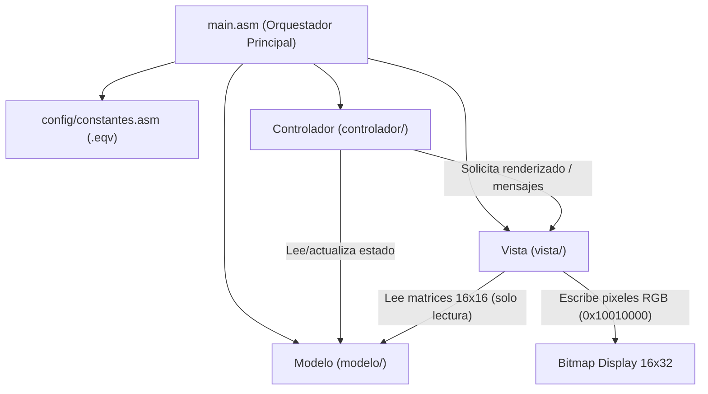

# Arquitectura MVC — Proyecto BattleShip (MIPS R2000 / MARS 4.5)

El proyecto está organizado bajo el patrón **Modelo–Vista–Controlador (MVC)** en subdirectorios modulares ensamblados desde [`main.asm`](main.asm) mediante directivas `.include`.

Esta estructura permite que los **3 integrantes** trabajen en archivos independientes sin conflictos de fusión (`merge conflicts`) ni errores de alineación o solapamiento sobre el `Bitmap Display` (`0x10010000`).

---

## 1. Diagrama de Dependencias MVC



---

## 2. Distribución de Carpetas y Mini-Módulos

```text
BattleShip/
├── main.asm                        # Único .asm en la raíz (compatible con Project Mode en MARS)
├── config/
│   └── constantes.asm              # Paleta RGB, dimensiones 16x32, estados y códigos ASCII
├── modelo/                         # [M] Estado lógico y reglas (NO dibuja ni lee teclado)
│   ├── tableros.asm                # (.data) tablero_defensa, tablero_ataque, tablero_enemigo
│   ├── flota.asm                   # (.data) longitudes_flota (5,4,3,2) y nombres_flota
│   ├── tableros_ops.asm            # (.text) limpiar_matriz_256, inicializar_demo_tableros, contar_barcos_restantes
│   └── validacion_flota.asm        # (.text) validar_posicion_barco (límites y colisiones)
├── vista/                          # [V] Memoria de video y consola (NO modifica lógica de juego)
│   ├── display_buffer.asm          # (.data) display_buffer: .space 2048 en 0x10010000 (PRIMERO)
│   ├── mensajes.asm                # (.data) Cadenas de texto (.asciiz)
│   └── render_tablero.asm          # (.text) dibujar_celda, dibujar_tablero_base, dibujar_preview_barco, limpiar_pantalla_agua, imprimir_coordenadas
└── controlador/                    # [C] Flujo de usuario, entrada, movimiento y comodines
    ├── teclado.asm                 # (.text) leer_tecla (syscall 12 + alternativa MMIO)
    ├── cursor.asm                  # (.text) mover_cursor y mover_cursor_ataque
    ├── colocacion_flota.asm        # (.text) colocar_flota_manual
    ├── comodines.asm               # (.text) intentar_comodin_radar, intentar_comodin_area, ejecutar_comodin
    └── combate_demo.asm            # (.text) procesar_disparo_simple y ejecutar_demo_ataque
```

---

## 3. Reglas de Oro para Integración en MARS 4.5

1. **`display_buffer` siempre primero en `.data`:** En [`main.asm`](main.asm), [`vista/display_buffer.asm`](vista/display_buffer.asm) debe mantenerse como la primera directiva de datos para ocupar exactamente `0x10010000 – 0x100107FF`.
2. **Solo `main.asm` en la carpeta raíz:** Todos los submódulos van dentro de sus subcarpetas para que la opción *Assemble all files in directory* de MARS nunca duplique símbolos ni desordene `.data`.
3. **Alineación `.word`:** Cualquier nuevo arreglo `.word` agregado por el equipo debe ir precedido de `.align 2` y nunca antes de `display_buffer`.
4. **Convención ABI estricta:**
   - Toda subrutina no-hoja debe guardar `$ra` y los `$s0-$s7` que use en `$sp` al entrar y restaurarlos al salir.
   - Argumentos por `$a0-$a3`; valores de retorno por `$v0-$v1`.

---

## 4. Guía de Trabajo para Integrantes 1 y 3

### Integrante 1 — Menú, Inicialización y Flota Enemiga IA
Archivos sugeridos para crear sin tocar el código del Integrante 2:
- `modelo/generador_ia.asm`: subrutina `generar_flota_enemiga` que puebla `tablero_enemigo` aleatoriamente (`syscall 42`) con los barcos `5, 4, 3, 2` en $Y \in [0, 15]$.
- `vista/menu_ui.asm`: cadenas y pantalla de bienvenida/reglas en consola o título.
- `controlador/menu_principal.asm`: bucle del menú inicial que sustituye a `inicializar_demo_tableros` en `main.asm`.

### Integrante 3 — Motor de Turnos, Ataque IA y Victoria
Archivos sugeridos para crear:
- `modelo/estado_partida.asm`: contadores de impactos/barcos restantes para Jugador y CPU.
- `controlador/turno_ia.asm`: algoritmo de disparo de la IA sobre `tablero_defensa`, actualizando la mitad inferior ($Y \in [16, 31]$) con `dibujar_tablero_base(tablero_defensa, 16, -1)`.
- `controlador/combate.asm`: reemplaza `controlador/combate_demo.asm` en `main.asm` integrando:
  1. `intentar_comodin_radar` al inicio del turno del jugador.
  2. `mover_cursor_ataque` para apuntar en $Y \in [0, 15]$.
  3. `intentar_comodin_area` (y si `$v0 == 0`, disparo normal de 1 casilla).
  4. Turno de la IA (`turno_ia.asm`) y verificación de fin de partida (`contar_barcos_restantes`).
